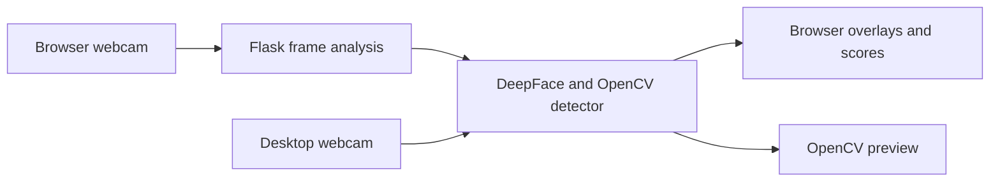

# EmoDet

A Python computer vision demo that estimates facial expression labels from webcam frames. It includes a Flask browser interface and an OpenCV desktop interface. Both use the same DeepFace detector.

## Run locally

The project documents Python 3.10 and 3.11. On macOS or Linux, create a virtual environment and install the dependencies from the application directory.

```sh
git clone https://github.com/khurik662/EmoDet_cl.git
cd EmoDet_cl/files/emotion-detection
python3.11 -m venv .venv
source .venv/bin/activate
python -m pip install -r requirements.txt
```

**Browser.** Run `python -m flask --app app run --host 127.0.0.1 --port 5000`. Open <http://127.0.0.1:5000>, choose **Start Camera**, and allow camera access. Use `/health` to check whether Flask is running.

**Desktop.** Run `python main.py`. Press **P** to pause or resume and **Q** to quit. Use `python main.py --help` for camera and detector options.

## Architecture



| Component | Role |
| --- | --- |
| [`app.py`](files/emotion-detection/app.py) | Serves the browser UI and analyzes frames sent to `POST /analyze`. |
| [`main.py`](files/emotion-detection/main.py) | Captures frames and renders annotations in the desktop window. |
| [`detector.py`](files/emotion-detection/detector.py) | Shares face detection and expression scoring between both modes. |
| [`templates/`](files/emotion-detection/templates) and [`static/`](files/emotion-detection/static) | Browser camera controls, results and overlays. |

The browser sends webcam frames to the Flask process. Use the loopback address above for a local demo. Model scores describe visual expression categories, and should not be treated as evidence of someone’s internal emotional state.

See the [commit history](https://github.com/khurik662/EmoDet_cl/commits/main/) for project changes.
